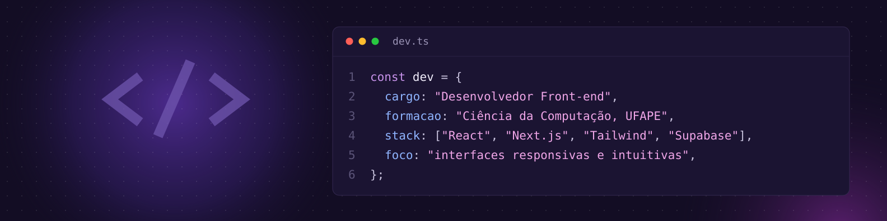
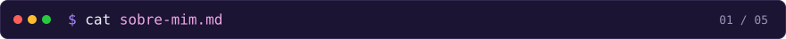
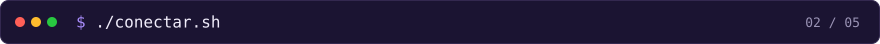
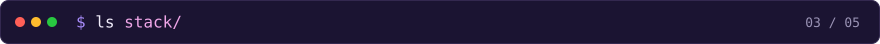
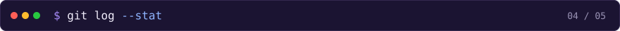
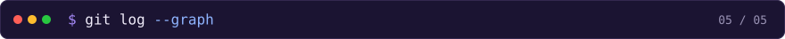

  

  <h1>Olá, eu sou o Eduardo Noronha</h1>

  <samp><strong>Desenvolvedor Front-end · UI Design</strong></samp>

    

  

 

Sou **desenvolvedor Front-end** e estudante de **Ciência da Computação** na **UFAPE**, com formação técnica em Desenvolvimento de Sistemas pela **ETE Ministro Fernando Lyra**.

Atuo profissionalmente com **desenvolvimento web**, criando e evoluindo sites, landing pages, interfaces e aplicações, com integrações de APIs, bancos de dados, deploy e manutenção.

No desenvolvimento de interfaces, busco **unir código e design** para construir experiências organizadas, responsivas e intuitivas.

Sigo me aprofundando em **React**, **Next.js**, **Node.js** e arquitetura de aplicações, por meio de projetos pessoais e acadêmicos.

 

   
  
  
  

 

   
  <table>
    <tr>
      <th><samp>front-end/</samp></th>
      <th><samp>design-e-cms/</samp></th>
      <th><samp>dados-e-ferramentas/</samp></th>
    </tr>
    <tr>
      <td align="center" valign="top">
        
      </td>
      <td align="center" valign="top">
        
         
        
      </td>
      <td align="center" valign="top">
        
      </td>
    </tr>
  </table>

  <samp><strong>aprofundando agora</strong></samp>
   
  

 

   
  

    

  
  

 

   
  

